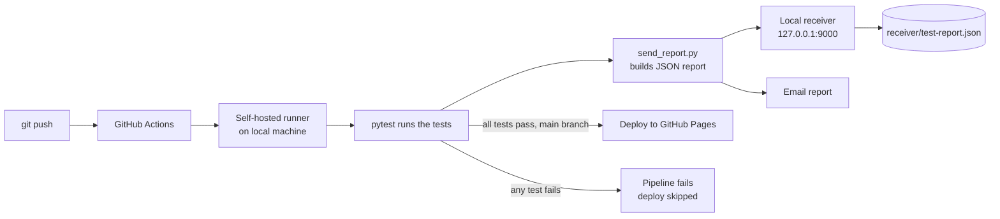

# Assignment Submission Portal with Automated Testing

[](https://github.com/Javeria-05/assignment-portal/actions/workflows/ci.yml)


A simple assignment submission portal where every code change is **tested automatically**. On every push, a GitHub Actions pipeline runs the tests, builds a JSON test report and sends it to a **local HTTP receiver**, which saves it as `test-report.json` on the developer's computer. The pipeline can also email the report and publish a static demo to GitHub Pages when all tests pass.

> **CSC418 DevOps - Lab Midterm Examination**
> Student: Javeria Irum (FA23-BSE-063)

| | |
|---|---|
| **Repository** | https://github.com/Javeria-05/assignment-portal |
| **Live demo (GitHub Pages)** | https://javeria-05.github.io/assignment-portal/ |

---

## Table of Contents

1. [Features](#features)
2. [How It Works](#how-it-works)
3. [Tech Stack](#tech-stack)
4. [Project Structure](#project-structure)
5. [Getting Started](#getting-started)
6. [Running the Tests](#running-the-tests)
7. [Starting the Report Receiver](#starting-the-report-receiver)
8. [CI Pipeline](#ci-pipeline)
9. [Self-Hosted Runner Setup](#self-hosted-runner-setup)
10. [Test Report Format](#test-report-format)
11. [Bonus Features](#bonus-features)
12. [Demo Workflow](#demo-workflow)
13. [Troubleshooting](#troubleshooting)

---

## Features

- Students enter their **name, registration number, assignment title and submission URL**.
- **Validation** of all required fields and of the URL (`http` or `https` with a host).
- Valid submissions are **saved** (JSON file) and shown in a **list** on the same page.
- **Automated tests** (pytest) run on every push.
- A failing test **fails the pipeline**.
- The **test report is sent automatically** to a local receiver for both passing and failing runs and saved as `test-report.json`.
- **Bonus:** email report after every run, and conditional deployment of a static demo to GitHub Pages.

## How It Works



A GitHub-hosted runner's `localhost` refers to the runner itself, not to your computer. To reach the receiver on `localhost`, the CI job runs on a **self-hosted runner installed on the local machine**.

## Tech Stack

| Component | Technology |
|---|---|
| Application | Python 3, Flask |
| Storage | JSON file (`submissions.json`) |
| Tests | pytest (JUnit XML output) |
| CI | GitHub Actions, self-hosted runner (Windows) |
| Report receiver | Python `http.server` |
| Static demo | HTML, CSS, JavaScript on GitHub Pages |
| Email | SMTP (Gmail), credentials in GitHub secrets |

## Project Structure

```
assignment-portal/
├── app.py                      # Flask app: validation, saving, listing
├── templates/
│   └── index.html              # Portal page
├── static/
│   └── style.css               # Portal styling
├── tests/
│   └── test_app.py             # Automated test cases
├── receiver/
│   └── receiver.py             # Local HTTP receiver -> test-report.json
├── scripts/
│   └── send_report.py          # Builds the JSON report and POSTs it
├── site/
│   ├── index.html              # Static demo for GitHub Pages
│   └── style.css
├── .github/workflows/
│   └── ci.yml                  # CI pipeline
├── requirements.txt
├── pytest.ini
└── README.md
```

## Getting Started

### Prerequisites

- Python 3.10 or newer
- Git
- A GitHub account (for the CI pipeline)

### Install and run the application

```bash
# 1. Clone the repository
git clone https://github.com/Javeria-05/assignment-portal.git
cd assignment-portal

# 2. (Optional) create a virtual environment
python -m venv venv
venv\Scripts\activate          # Windows
# source venv/bin/activate     # Linux / macOS

# 3. Install dependencies
pip install -r requirements.txt

# 4. Run the application
python app.py
```

Open **http://127.0.0.1:5000** in the browser.

### Using the portal

1. Fill in the name, registration number, assignment title and submission URL.
2. Click **Submit Assignment**.
3. If something is missing or the URL is invalid, validation messages are shown and nothing is saved.
4. Valid submissions appear in the **Saved Submissions** table.

## Running the Tests

```bash
python -m pytest -v
```

| Test | Input | Expected result |
|---|---|---|
| `test_valid_submission_is_saved_and_listed` | Complete details and a valid URL | Saved and shown in the list |
| `test_missing_registration_number_is_rejected` | Empty registration number | Rejected with a validation message |
| `test_invalid_url_is_rejected_and_not_saved` | Invalid submission URL | Rejected and not saved |

The tests use a temporary data file, so they never touch real submissions.

## Starting the Report Receiver

The receiver is a small HTTP server that accepts the test report sent by the pipeline and saves it as `test-report.json`.

```bash
python receiver/receiver.py
```

```
Receiver listening on http://127.0.0.1:9000/report
```

- Endpoint: `POST http://127.0.0.1:9000/report`
- Output file: `receiver/test-report.json` (overwritten by each new report)
- Keep this terminal open while pushing code.

To send a report to a different address, set the `RECEIVER_URL` environment variable before running `scripts/send_report.py`.

## CI Pipeline

The workflow in [`.github/workflows/ci.yml`](.github/workflows/ci.yml) runs on **every push** and has two jobs.

### `test` job (self-hosted runner)

| Step | Description |
|---|---|
| Checkout | Fetches the pushed revision |
| Install dependencies | `python -m pip install -r requirements.txt` |
| Run tests | `python -m pytest -v --junitxml=report.xml`. A failed test fails this step and the job |
| Send report to receiver | `python scripts/send_report.py` with `if: always()`, so it runs for passing and failing runs |
| Email report | Emails the summary and `report.json` with `if: always()` |

### `deploy` job (bonus)

Runs only when the `test` job succeeds (`needs: test`) **and** the branch is `main`. If any test fails, the deploy job is skipped and the previously published page stays unchanged.

## Self-Hosted Runner Setup

1. In the repository, go to **Settings → Actions → Runners → New self-hosted runner** and choose your OS.
2. Run the download and configure commands shown on that page, for example on Windows:

   ```powershell
   cd C:\
   mkdir actions-runner; cd actions-runner
   # download and extract the runner package (commands shown by GitHub)
   ./config.cmd --url https://github.com/Javeria-05/assignment-portal --token <TOKEN_FROM_GITHUB>
   ```

3. Press Enter for the default answers. Answer **N** when asked to run as a service.
4. Start the runner:

   ```powershell
   ./run.cmd
   ```

   `Listening for Jobs` confirms that it is ready. Keep this window open.

> The registration token is shown by GitHub and expires quickly. Never commit it or share it.

## Test Report Format

`receiver/test-report.json` contains the run information and the real test results:

```json
{
  "repository": "Javeria-05/assignment-portal",
  "branch": "main",
  "commit_sha": "<full commit SHA>",
  "pipeline_run_id": "<GitHub run id>",
  "timestamp": "2026-10-29T05:56:38+00:00",
  "tests": [
    {
      "name": "test_valid_submission_is_saved_and_listed",
      "result": "passed",
      "failure_message": null
    },
    {
      "name": "test_missing_registration_number_is_rejected",
      "result": "failed",
      "failure_message": "assertion error text ..."
    },
    {
      "name": "test_invalid_url_is_rejected_and_not_saved",
      "result": "passed",
      "failure_message": null
    }
  ],
  "total": 3,
  "passed": 2,
  "failed": 1,
  "overall_status": "failed"
}
```

The report is built from the actual pytest results (`report.xml`), and is delivered for **both passing and failing runs**.

## Bonus Features

### Conditional deployment to GitHub Pages

- The static demo in `site/` is published to **https://javeria-05.github.io/assignment-portal/**.
- It is deployed only after a push to `main` **and** only when all tests pass.
- GitHub Pages hosts static files only, so the demo keeps its data in the browser; the Flask backend is not deployed.
- Setup: **Settings → Pages → Source: GitHub Actions**.

### Email report

After every run (passing or failing), an email is sent with the commit identifier, the overall result, the test counts and each test result, with `report.json` attached.

Credentials are never stored in the code. Add these **repository secrets** (Settings → Secrets and variables → Actions):

| Secret | Value |
|---|---|
| `MAIL_USERNAME` | Gmail address used to send |
| `MAIL_PASSWORD` | Google **App Password** (needs 2-Step Verification) |
| `MAIL_TO` | Address that receives the report |

## Demo Workflow

1. **Passing run:** push a correct revision. The pipeline is green, `test-report.json` shows `overall_status: passed`, and the demo is deployed.
2. **Failing run:** disable the registration number check in `validate()` in `app.py` and push. `test_missing_registration_number_is_rejected` fails, the pipeline is red, `test-report.json` is updated with `overall_status: failed` and the failure message, and the deploy job is skipped.
3. **Fix:** restore the check and push. The pipeline is green again and the report shows `passed`.

Before each demo, start the receiver (`python receiver/receiver.py`) and the runner (`./run.cmd`).

## Troubleshooting

| Problem | Likely cause and fix |
|---|---|
| Run stays **Queued** | The runner is not running. Start it with `./run.cmd` |
| Run fails at **Send report** | The receiver is not running. Start `python receiver/receiver.py` |
| Email step fails | Check the three secrets and use a Google App Password, not the account password |
| Pages deploy fails | Set **Settings → Pages → Source** to *GitHub Actions* (the repository must be public on a free plan) |

## Author

**Javeria Irum** - FA23-BSE-063
CSC418 DevOps - Lab Midterm Examination
